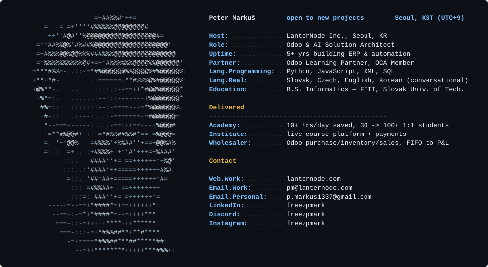

 

<h2 align="center">📊 Stats</h2>

 
 

 

<h2 align="center">👋 About</h2>

I implement Odoo and build AI automation for education and service companies. Odoo alone, AI alone, or both. Software engineer turned consultant; founder since 2025.

**What I build**

- Odoo ERP end to end: scoping, configuration, custom development, deployment, hosting, support
- AI and business process automation for the reading, answering and routine admin around the business

**Delivered**

- 2026 - now: building an AI SaaS for language teachers/students, and my own AI operating system of agents
- 2025 - now: implemented and run Odoo for a 22-user B2B wholesaler and a Seoul career-training institute
- 2023 - 2025: CTO, 1:1 English academy, 10+ hrs/day saved, supporting growth from 30 to 100+ students
- 2021 - 2022: on contract, co-built a Czech/Slovak accounting system for 20+ SMEs, cut admin time 30%+
- 2018 - 2020: employed at a telecom as an Odoo developer, saving the sales team 10+ hrs/week
- 5+ years in Odoo and business systems, across corporate, contract, startup and SaaS

**Who this is for**

Language academies, training institutes and course platforms. More broadly, any service business where the relationship is the product and the back office eats the hours.

**How I work**

I learned early that the hard part is understanding what a business needs, then making it work. So I'll tell you what fits: Odoo, an AI-native build, both, or neither. Most people need less than they think, and sometimes the answer is that we're not a fit. The recommendation is yours to keep even if you walk away.

Send me what your week  looks like and I'll tell you straight what is worth doing. pm@lanternode.com

<h2 align="center">✍️ Writing</h2>

- [Odoo vs AI: Should AI Build Your Business Software?](https://www.lanternode.com/blog/insights-6/odoo-vs-ai-should-ai-build-your-business-software-4): where AI genuinely wins at building business software, and the three things it cannot shortcut
- [Odoo Experience 2025: Simplicity at Scale](https://www.lanternode.com/blog/events-1/odoo-experience-2025-simplicity-at-scale-3): notes from Brussels on Odoo 19, company culture, and what changes for implementers

 

 
<b>💻 Tech Stack (Click Me!)</b>

 
<b>📚 Learning Resources (Click Me!)</b>

 ### Coursera Courses:
 ✔️ Machine Learning: Classification (21 hrs)  
 ✔️ Learning How to Learn (15 hrs)  
 ✔️ AI For Everyone (10 hrs)  
 ✔️ Specialization: Mathematics for Machine Learning and Data Science (60 hrs)  
 ✔️ Specialization: Machine Learning (108 hrs)  
 ✔️ Specialization: Deep Learning (140 hrs)  
 ✔️ Specialization: Natural Language Processing (128 hrs)  
 ✔️ Generative AI with Large Language Models (16 hrs)  

 ### Books:
 ✔️ Programming in Python 3 (Mark Summerfield)  
 ✔️ Building Chatbots with Python (Sumit Raj)  

